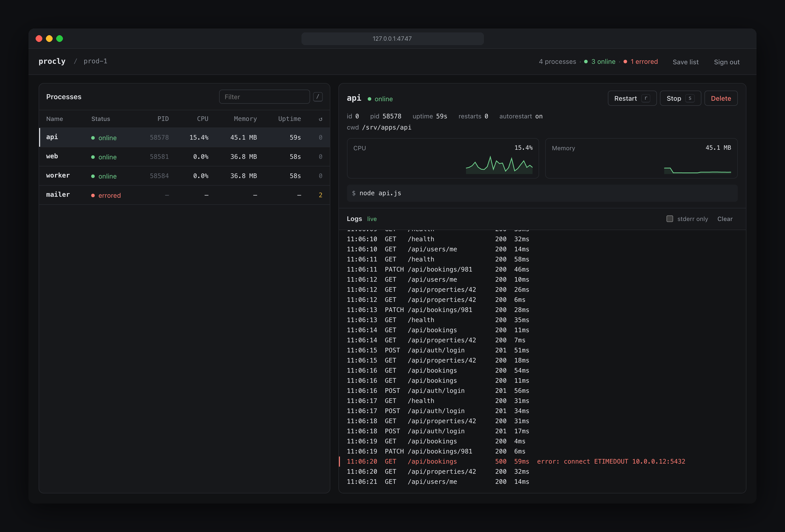

# procly

A process manager for your servers. One small binary, no runtime needed.
Runs Node, Python, Go, or any other command, restarts it when it crashes,
keeps its logs, and brings everything back after a reboot.

<picture>
  <source media="(prefers-color-scheme: light)" srcset="docs/monit-light.png">
  
</picture>

> Status: early MVP. The CLI, daemon, terminal dashboard and web panel work; multi-server support is next.

## Install

With Go 1.22 or newer:

```sh
go install github.com/itsahmadnyc/procly/cmd/procly@latest
```

Or from source:

```sh
git clone https://github.com/itsahmadnyc/procly && cd procly
go build -o /usr/local/bin/procly ./cmd/procly
```

## Quick start

```sh
procly start server.js --name api -e PORT=3000
procly start "npm run start" --name web
procly ls
```

```
  id   name   status       pid   uptime   restarts   cpu    memory
   0   api    ● online   38985   3m              0   0.3%   48.6 MB
   1   web    ● online   38998   3m              0   0.1%   45.5 MB

  2 processes · 2 online
```

## Commands

| Command | What it does |
|---|---|
| `procly start <file\|command\|config>` | Start a process, or every app in a config file |
| `procly stop <name\|id\|all>` | Stop (SIGTERM, then SIGKILL after 5s) |
| `procly restart <name\|id\|all>` | Restart |
| `procly delete <name\|id\|all>` | Stop and forget |
| `procly ls` | Table of processes with CPU and memory |
| `procly describe <name>` | Everything about one process |
| `procly logs [name]` | Print recent lines and follow |
| `procly monit` | Live dashboard: processes, CPU/memory graphs, logs |
| `procly web` | Web panel for the same, in the browser |
| `procly save` / `procly resurrect` | Remember the process list / bring it back |
| `procly startup` | Start on boot (systemd on Linux, launchd on macOS) |
| `procly kill` | Stop all processes and the daemon |

Files are run by extension (`.js` with node, `.py` with python3, `.sh` with bash, ...).
Arguments for your script go after `--`: `procly start app.js -- --port 3000`.

## Live dashboard

`procly monit` opens a full-screen view of every process with CPU and memory
sparklines and the selected process's logs streaming underneath.

| Key | Action |
|---|---|
| `↑` `↓` / `k` `j` | Select a process |
| `r` | Restart |
| `s` | Stop, or start if stopped |
| `d` | Delete (asks first) |
| `enter` | Expand logs, `esc` to go back |
| `?` | All keys |
| `q` | Quit (processes keep running) |

Colors follow your terminal theme. If it guesses light/dark wrong, set
`PROCLY_THEME=light` or `PROCLY_THEME=dark`.

## Web panel

<picture>
  <source media="(prefers-color-scheme: light)" srcset="docs/web-light.png">
  
</picture>

```sh
procly web                  # http://127.0.0.1:4747
procly web --port 8080
procly web --addr 0.0.0.0:4747
procly web --reset-password
```

The first start prints a random password once; only a bcrypt hash is stored
(`~/.procly/web.json`). The panel shows every process with live CPU and memory,
streams logs, and can restart, stop, start and delete. Keys: `j`/`k` to move,
`r` restart, `s` stop/start, `/` filter.

It listens on localhost by default. To reach it from your laptop, either tunnel:

```sh
ssh -L 4747:localhost:4747 you@your-server
```

or put it behind HTTPS with a reverse proxy, for example Caddy:

```
panel.example.com {
    reverse_proxy 127.0.0.1:4747
}
```

To keep the panel running, start it once by hand to note the password, stop it, then let procly run it:
`procly start "procly web" --name panel`.

Security: sessions are HttpOnly, SameSite=Strict cookies; every write needs an
`X-Procly` header (CSRF); five wrong passwords lock an IP out for ten minutes;
environment variable values never leave the server, only their names.

## Config file

```yaml
# procly.yml
apps:
  - name: api
    command: node server.js
    cwd: ./api
    env:
      PORT: 3000
  - name: worker
    command: python3 worker.py
    max_restarts: 5
```

```sh
procly start procly.yml
```

| Field | Default | |
|---|---|---|
| `name` | required | letters, digits, `.`, `_`, `-` |
| `command` | required | run with `/bin/sh -c` |
| `cwd` | config file's folder | relative paths resolve from the config file |
| `env` | | added to the environment |
| `autorestart` | `true` | |
| `max_restarts` | `15` | quick crashes in a row before giving up |
| `restart_delay_ms` | `1000` | doubles per crash, capped at 30s |
| `kill_timeout_ms` | `5000` | time between SIGTERM and SIGKILL |

## How it works

`procly` talks to a background daemon over a unix socket (`~/.procly/procly.sock`,
owner-only). The CLI starts the daemon the first time you need it. Each process runs
in its own process group, so stopping it also stops anything it spawned.
A process that runs for 30 seconds resets its crash counter.

State lives in `~/.procly` (override with `PROCLY_HOME`):

```
~/.procly/
  daemon.log
  dump.json          # written by `procly save`
  logs/<name>-out.log
  logs/<name>-error.log
```

## Roadmap

- [x] Daemon, auto-restart with backoff, logs, CPU/memory, config file, save/resurrect, boot startup
- [x] Interactive terminal UI (`procly monit`)
- [x] Web panel, embedded in the binary
- [ ] Connect several servers to one panel
- [ ] Log rotation, health checks, alerts, deploy from git

## License

MIT
