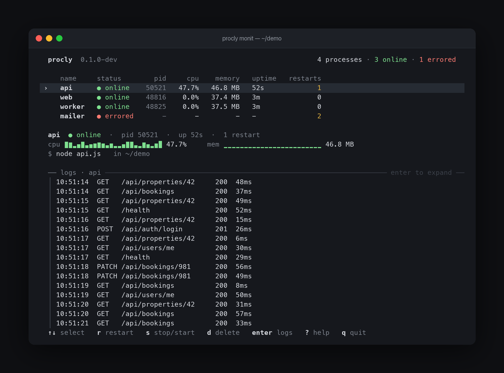

# procly

A process manager for your servers. One small binary, no runtime needed.
Runs Node, Python, Go, or any other command, restarts it when it crashes,
keeps its logs, and brings everything back after a reboot.

<picture>
  <source media="(prefers-color-scheme: light)" srcset="docs/monit-light.png">
  
</picture>

> Status: early MVP. The CLI, daemon, terminal dashboard, web panel and multi-server support work.

## Install

Linux or macOS, amd64 or arm64:

```sh
curl -fsSL https://raw.githubusercontent.com/itsahmadnyc/procly/main/install.sh | sh
```

The script downloads the latest release, checks it against `checksums.txt`
and puts `procly` in `/usr/local/bin` (using sudo if needed) or `~/.local/bin`.
Pin a version with `PROCLY_VERSION=0.1.0`, or pick the folder with
`PROCLY_INSTALL_DIR`. Prefer to look first? Read [install.sh](install.sh), or
download an archive from [Releases](https://github.com/itsahmadnyc/procly/releases).

With Go (1.21 or newer fetches the required toolchain itself):

```sh
go install github.com/itsahmadnyc/procly/cmd/procly@latest
```

From source:

```sh
git clone https://github.com/itsahmadnyc/procly && cd procly
go build -o /usr/local/bin/procly ./cmd/procly
```

## Quick start

```sh
procly start server.js --name api -e PORT=3000
procly start "npm run start" --name web
procly ls
```

```
  id   name   status       pid   uptime   restarts   cpu    memory
   0   api    ● online   38985   3m              0   0.3%   48.6 MB
   1   web    ● online   38998   3m              0   0.1%   45.5 MB

  2 processes · 2 online
```

## Commands

| Command | What it does |
|---|---|
| `procly start <file\|command\|config>` | Start a process, or every app in a config file |
| `procly stop <name\|id\|all>` | Stop (SIGTERM, then SIGKILL after 5s) |
| `procly restart <name\|id\|all>` | Restart |
| `procly delete <name\|id\|all>` | Stop and forget |
| `procly ls` | Table of processes with CPU and memory |
| `procly describe <name>` | Everything about one process |
| `procly logs [name]` | Print recent lines and follow |
| `procly monit` | Live dashboard: processes, CPU/memory graphs, logs |
| `procly web` | Web panel for the same, in the browser |
| `procly agent` | Let another server's panel manage this one |
| `procly server add/ls/rm` | Connect, list and remove other servers |
| `procly hub` / `server invite` | Manage servers behind NAT that dial in |
| `procly save` / `procly resurrect` | Remember the process list / bring it back |
| `procly startup` | Start on boot (systemd on Linux, launchd on macOS) |
| `procly kill` | Stop all processes and the daemon |

Files are run by extension (`.js` with node, `.py` with python3, `.sh` with bash, ...).
Arguments for your script go after `--`: `procly start app.js -- --port 3000`.

## Live dashboard

`procly monit` opens a full-screen view of every process with CPU and memory
sparklines and the selected process's logs streaming underneath.

| Key | Action |
|---|---|
| `↑` `↓` / `k` `j` | Select a process |
| `r` | Restart |
| `s` | Stop, or start if stopped |
| `d` | Delete (asks first) |
| `enter` | Expand logs, `esc` to go back |
| `?` | All keys |
| `q` | Quit (processes keep running) |

Colors follow your terminal theme. If it guesses light/dark wrong, set
`PROCLY_THEME=light` or `PROCLY_THEME=dark`.

## Web panel

<picture>
  <source media="(prefers-color-scheme: light)" srcset="docs/web-light.png">
  
</picture>

```sh
procly web                  # http://127.0.0.1:4747
procly web --port 8080
procly web --addr 0.0.0.0:4747
procly web --reset-password
```

The first start prints a random password once; only a bcrypt hash is stored
(`~/.procly/web.json`). The panel shows every process with live CPU and memory,
streams logs, and can restart, stop, start and delete. Keys: `j`/`k` to move,
`r` restart, `s` stop/start, `/` filter.

It listens on localhost by default. To reach it from your laptop, either tunnel:

```sh
ssh -L 4747:localhost:4747 you@your-server
```

or put it behind HTTPS with a reverse proxy, for example Caddy:

```
panel.example.com {
    reverse_proxy 127.0.0.1:4747
}
```

To keep the panel running, start it once by hand to note the password, stop it, then let procly run it:
`procly start "procly web" --name panel`.

Security: sessions are HttpOnly, SameSite=Strict cookies; every write needs an
`X-Procly` header (CSRF); five wrong passwords lock an IP out for ten minutes;
environment variable values never leave the server, only their names.

## Several servers

One panel can manage many machines. On every extra server, run the agent:

```sh
procly agent                # listens on 0.0.0.0:4748 over TLS
```

It prints a one-time token and its certificate fingerprint, ready to paste on
the server that runs `procly web`:

```sh
procly server add prod-2 https://203.0.113.7:4748 \
  --token <token> \
  --fingerprint sha256:<fingerprint>
procly server ls
```

The panel shows a tab per server (switch with `[` and `]`), each with its own
processes, graphs and logs. Unreachable servers are marked instead of slowing
the others down.

From the terminal, add `--server` (or `-S`) to work on another server:

```sh
procly ls --server prod-2
procly logs api -S prod-2
procly restart all -S prod-2
export PROCLY_SERVER=prod-2   # make it the default; --server local goes back
```

It works with `ls`, `describe`, `stop`, `restart`, `delete`, `logs` and `save`.
`start` stays local: run it on the server itself, then manage it from anywhere.

How it stays safe:

- The agent makes a self-signed certificate on first start. The hub trusts that
  exact certificate by fingerprint, so nobody in between can pose as the agent,
  and the token is never sent to a server with a different certificate.
- The token is 256 random bits. The agent stores only its SHA-256; the hub keeps
  it in `~/.procly/servers.json` (mode 600). New token: `procly agent --reset-token`.
- An agent can list, restart, stop, start, delete and stream logs. It cannot
  start new commands.
- Open the agent port only to your panel server in the firewall, for example
  `ufw allow from <panel-ip> to any port 4748`.

### Servers behind NAT

When a server can't accept incoming connections (home lab, office network, no
open ports), let it dial out to the hub instead.

On the hub (the server that runs `procly web`):

```sh
procly start "procly hub" --name procly-hub    # listens on :4749 for agents
procly server invite office-1 --hub-address hub.example.com:4749
```

`invite` prints two commands to run on the other server:

```sh
procly agent join hub.example.com:4749 --name office-1 \
  --fingerprint sha256:<hub fingerprint> --token <token>
procly start "procly agent connect" --name procly-agent
```

The agent keeps one TLS connection open to the hub and reconnects on its own.
Requests and live logs run as HTTP/2 streams over that connection, so
`procly web`, `procly ls -S office-1` and everything else work the same as for
directly reachable servers.

- The agent pins the hub's certificate by fingerprint; the hub checks the
  agent's token against the hash it stored at `invite`. Neither side trusts a CA.
- `join` saves its settings to `~/.procly/agent-connect.json` (mode 600), so
  the token never appears on a command line or in `procly ls`.
- `procly server invite <name>` again issues a new token and drops the old
  connection; `procly server rm <name>` cuts it off within ten seconds.
- Only the hub's port 4749 needs to be reachable; the agent opens nothing.

## Config file

```yaml
# procly.yml
apps:
  - name: api
    command: node server.js
    cwd: ./api
    env:
      PORT: 3000
  - name: worker
    command: python3 worker.py
    max_restarts: 5
```

```sh
procly start procly.yml
```

| Field | Default | |
|---|---|---|
| `name` | required | letters, digits, `.`, `_`, `-` |
| `command` | required | run with `/bin/sh -c` |
| `cwd` | config file's folder | relative paths resolve from the config file |
| `env` | | added to the environment |
| `autorestart` | `true` | |
| `max_restarts` | `15` | quick crashes in a row before giving up |
| `restart_delay_ms` | `1000` | doubles per crash, capped at 30s |
| `kill_timeout_ms` | `5000` | time between SIGTERM and SIGKILL |

## How it works

`procly` talks to a background daemon over a unix socket (`~/.procly/procly.sock`,
owner-only). The CLI starts the daemon the first time you need it. Each process runs
in its own process group, so stopping it also stops anything it spawned.
A process that runs for 30 seconds resets its crash counter.

State lives in `~/.procly` (override with `PROCLY_HOME`):

```
~/.procly/
  daemon.log
  dump.json          # written by `procly save`
  logs/<name>-out.log
  logs/<name>-error.log
```

## Development

```sh
go test -race ./...
```

Tests start real processes, daemons and TLS connections on localhost, and the
CLI tests build and run the actual binary. Before a pull request, also run
`gofmt -l .` and `go vet ./...`, and if you can, the tests on both Linux and
macOS: process groups, `ps` and `/bin/sh` differ between them.

## Roadmap

- [x] Daemon, auto-restart with backoff, logs, CPU/memory, config file, save/resurrect, boot startup
- [x] Interactive terminal UI (`procly monit`)
- [x] Web panel, embedded in the binary
- [x] Connect several servers to one panel
- [ ] Log rotation, health checks, alerts, deploy from git

## License

MIT
