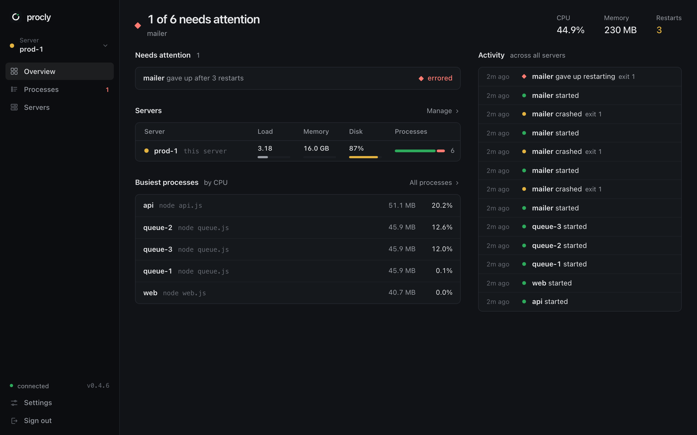
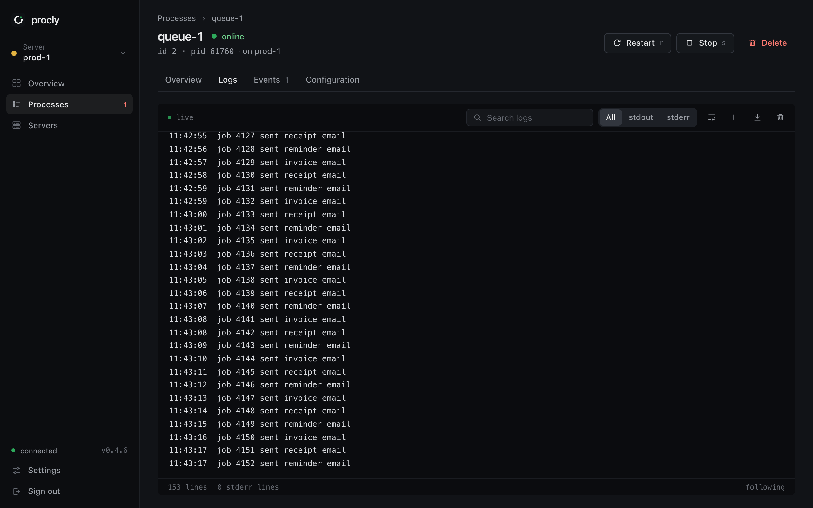

<h1> procly</h1>

**A process manager for your servers.** One small binary, no runtime needed. It
runs Node, Python, Go or any other command, restarts it when it crashes, keeps
its logs, and gives you a terminal dashboard and a web panel for all of it,
across as many servers as you have.

[](https://github.com/itsahmadnyc/procly/actions/workflows/ci.yml)
[](https://www.npmjs.com/package/procly)
[](https://github.com/itsahmadnyc/procly/releases)
[](LICENSE)


[Install](#install) · [Quick start](#quick-start) · [Web panel](#web-panel) · [Several servers](#several-servers) · [Coming from PM2](#coming-from-pm2) · [Contributing](#contributing)

<picture>
  <source media="(prefers-color-scheme: light)" srcset="docs/web-overview-light.png">
  
</picture>

## What you get

- **Keeps things running.** Restarts a crashed process with a growing delay, and
  gives up after 15 quick crashes in a row instead of looping forever.
- **Knows when something is wrong.** Health checks (`http://` or `tcp://`),
  and Telegram or Slack messages on crashes, give-ups and failed checks.
- **Logs that behave.** Rotated at 10 MB without restarting the process, and
  searchable live in the panel.
- **A terminal dashboard** (`procly monit`) and **a web panel** you host
  yourself: light and dark, works on a phone, asks before it interrupts anything.
- **Many servers, one panel.** Connect servers directly, or let ones behind NAT
  dial in. Every connection pins a certificate; nothing trusts a CA.
- **Survives a reboot.** `procly save`, then `procly startup` for systemd or launchd.
- **Small.** A single binary of about 10 MB, and a daemon of about 11 MB with ten apps running. No Node needed to run it.

## Install

Linux or macOS, amd64 or arm64:

```sh
curl -fsSL https://raw.githubusercontent.com/itsahmadnyc/procly/main/install.sh | sh
```

The script downloads the latest release, checks it against `checksums.txt`
and puts `procly` in `/usr/local/bin` (using sudo if needed) or `~/.local/bin`.
Pin a version with `PROCLY_VERSION=0.1.0`, or pick the folder with
`PROCLY_INSTALL_DIR`. Prefer to look first? Read [install.sh](install.sh), or
download an archive from [Releases](https://github.com/itsahmadnyc/procly/releases).

With Homebrew (macOS and Linux):

```sh
brew install itsahmadnyc/tap/procly
```

With npm (the right binary for your system comes as an optional dependency;
Node is only used to start it):

```sh
npm install -g procly
```

With Go (1.21 or newer fetches the required toolchain itself):

```sh
go install github.com/itsahmadnyc/procly/cmd/procly@latest
```

From source:

```sh
git clone https://github.com/itsahmadnyc/procly && cd procly
go build -o /usr/local/bin/procly ./cmd/procly
```

## Upgrading

```sh
procly upgrade --check      # is there a newer release?
procly upgrade              # install it and hand the daemon over
```

`procly upgrade` downloads the latest release, checks it against the release's
`checksums.txt` (like `install.sh`), and replaces the binary (with `sudo` when the folder is
not yours, as `install.sh` does; the old one is kept as `procly.old` until the end). Then it
hands the daemon over to the new binary:

- The running daemon passes its list on and exits **without stopping your apps**.
- A daemon from the new binary starts, and **every running app is restarted once, one at a
  time**: the app is stopped where it is and started again from its settings, and the next one
  is not touched until this one serves again: on Linux, until it accepts connections on the
  TCP ports the old process listened on (found in `/proc`, nothing to configure), and until it
  passes its health check if it has one; at most a minute. An app that listens on nothing only
  needs to be running. On macOS only the health check is waited for. The instances of a group
  roll, so the others keep serving.
- **Stopped apps stay stopped**, still in the list, and **your saved list is not changed**
  (`procly save` is for you to decide).
- Between the old daemon leaving and an app's turn, that app keeps running but nothing
  restarts it if it crashes; that window is as long as the apps before it take.

Why apps restart at all: a new daemon can list and stop the apps an old one left behind
(see [what happens when the daemon dies](docs/daemon-failure.md)) but cannot yet supervise
them, so each app is restarted under it instead. A handover that keeps them running is on
the roadmap.

If the new daemon does not start, procly puts the old binary back and restarts the apps
under it. If the command is interrupted after the old daemon left, run `procly upgrade`
again: it finishes the restarts from `~/.procly/upgrade.json`, skipping the apps already done.
`procly upgrade --dry-run` shows the plan and changes nothing; `--no-restart` only replaces the
binary (the daemon and the apps keep running the old version; run `procly upgrade` again later
to hand over); `--version 0.4.0` installs that version, also an older one.

Two cases do less, on purpose:

- **A daemon run by systemd** (from `procly startup`) is not handed over: stopping the service
  would stop the apps with it. The binary is replaced and the command prints what to run:
  `procly save && sudo systemctl restart procly`, which restarts every app together from the
  saved list.
- **Homebrew and npm** own their binaries: `procly upgrade` says to use `brew upgrade procly`
  or `npm update -g procly`, and `procly upgrade --check` still works.

Apps that run `procly web` or `procly agent` outside procly keep the old code until you
restart them. Downloads come from GitHub; set `PROCLY_DOWNLOAD_BASE` to a mirror, as for
`install.sh`. The first release with `upgrade` is 0.4.0; to get there from an older one, run
`install.sh` and then `procly save && procly kill && procly resurrect`.

## Quick start

```sh
procly start server.js --name api -e PORT=3000
procly start "npm run start" --name web
procly ls
```

```
  id   name   status       pid   uptime   restarts   cpu    memory
   0   api    ● online   38985   3m              0   0.3%   48.6 MB
   1   web    ● online   38998   3m              0   0.1%   45.5 MB

  2 processes · 2 online
```

`start` runs a file by its extension (`.js`, `.mjs`, `.cjs` with `node`, `.ts` with
`npx tsx`, `.py`, `.rb`, `.php`, `.pl`, `.sh`), runs any executable file as it is
(`procly start ./server`), and takes any other command in quotes
(`procly start "go run ."`).

Then open the dashboards, and make it all come back after a reboot:

```sh
procly monit                # in the terminal
procly web                  # in the browser, http://127.0.0.1:4747
procly save && procly startup
```

## Web panel

<picture>
  <source media="(prefers-color-scheme: light)" srcset="docs/web-logs-light.png">
  
</picture>

```sh
procly web                  # http://127.0.0.1:4747
procly web --port 8080
procly web --addr 0.0.0.0:4747
procly web --reset-password
procly web --trusted-proxy 127.0.0.1   # behind a reverse proxy, see below
```

The first start prints a random password once; only a bcrypt hash is stored
(`~/.procly/web.json`).

- **Overview**: every server at a glance with load, memory and disk, what needs
  attention, and recent crashes and restarts across all of them.
- **Processes**: filter, restart, stop and start, with a confirmation before
  anything that interrupts a process. Deleting asks you to type its name.
- **One process**: live CPU and memory charts, its restart policy and health
  check, an event history with the last stderr lines of each crash, and
  searchable logs you can pause, wrap and download.
- **Servers**: every connected server, its host stats, and how to add another.
  The switcher in the sidebar changes which server the panel is looking at.
- **Settings**: light, dark or system theme, and how to set up alerts.

**New process** (or `n`) starts a command on the panel's own server, as the user
running procly; remote servers can't start new commands through their agents.
Keys: `g` then `o`, `p` or `s` jumps to Overview, Processes or Servers; on a
process, `r` restarts it, `s` stops or starts it and `l`, `e`, `c` open its logs,
events and configuration; `[` and `]` change server and `/` filters or searches.

It listens on localhost by default. To reach it from your laptop, either tunnel:

```sh
ssh -L 4747:localhost:4747 you@your-server
```

or put it behind HTTPS with a reverse proxy, for example Caddy:

```
panel.example.com {
    reverse_proxy 127.0.0.1:4747
}
```

or nginx (certificates from certbot or your own):

```nginx
server {
    listen 443 ssl;
    server_name panel.example.com;
    ssl_certificate     /etc/letsencrypt/live/panel.example.com/fullchain.pem;
    ssl_certificate_key /etc/letsencrypt/live/panel.example.com/privkey.pem;

    location / {
        proxy_pass http://127.0.0.1:4747;
        proxy_http_version 1.1;
        proxy_set_header Host $host;
        proxy_set_header X-Forwarded-Proto $scheme;
        proxy_set_header X-Forwarded-For $remote_addr;
    }
}
```

Both were run in front of the panel: login works, the session cookie gets
`Secure` from `X-Forwarded-Proto` (nginx needs the line above; Caddy sends it by
itself), and the live logs arrive as they are written, one line per second. The
panel tells nginx not to buffer the log stream, so no extra setting is needed.
Behind a proxy, tell the panel which address it may believe:

```sh
procly web --trusted-proxy 127.0.0.1
```

The login lockout (five wrong passwords, ten minutes) counts against the visitor's
address. Without the flag that is the connection's address, which behind a proxy is the
proxy's, so one person's typos would lock everyone out. With `--trusted-proxy`, a
connection from that address (repeat the flag or separate by commas; ranges like
`10.0.0.0/8` work) is trusted to say who the visitor is: the panel uses the last address in
`X-Forwarded-For` that is not itself a trusted proxy, which is the one your proxy appended.
Nothing is trusted by default, and the header from any other address is ignored, because
anyone can write it. Trust only the addresses your proxy connects from; the panel warns if
you trust every address.

### Serving HTTPS yourself

```sh
procly web --addr 0.0.0.0:8443 --tls-cert /etc/letsencrypt/live/panel.example.com/fullchain.pem \
                               --tls-key  /etc/letsencrypt/live/panel.example.com/privkey.pem
```

The panel then speaks HTTPS (TLS 1.2 or newer, HTTP/2 too) and the session cookie is `Secure`.
Both flags are needed, and a certificate that cannot be loaded stops the panel at start
with the reason. Use this when the panel is the only web service on the machine and you
have a certificate for it; use a reverse proxy (above) when the machine already serves
other sites on 443, when you want a redirect from HTTP, or when you would like the proxy to
get and renew certificates for you (Caddy does). Port 443 needs root or a capability, so a
high port is easier.

Renewed certificates need no restart. The panel looks at the two files every ten seconds and
loads the new pair when they change; a pair that does not load (a renewal writes the
certificate and the key one after the other) is reported once and the previous certificate
keeps being served until a good pair appears. It also loads them again on `SIGHUP`, for a
renewal hook: start the panel with `--reload-signal SIGHUP`, e.g.
`procly start "procly web --addr 0.0.0.0:8443 --tls-cert ... --tls-key ..." --name panel --reload-signal SIGHUP`,
and run `procly reload panel` from certbot's `--deploy-hook`.

To keep the panel running, start it once by hand to note the password, stop it, then let procly run it:
`procly start "procly web" --name panel`.

Security: sessions are HttpOnly, SameSite=Strict cookies; every write needs an
`X-Procly` header (CSRF); five wrong passwords lock an IP out for ten minutes;
environment variable values never leave the server, only their names.

## Live dashboard

<picture>
  <source media="(prefers-color-scheme: light)" srcset="docs/monit-light.png">
  
</picture>

`procly monit` opens a full-screen dashboard: every process with its CPU and
memory, the selected one's details (state in words, CPU and memory graphs,
`max_memory`, health, schedule, recent events), and its logs streaming
underneath. Instances show as one group you can fold, with their logs merged
and labelled. Wide terminals put the table and the details side by side,
narrow ones stack them and drop the columns that do not fit, and the mouse
works too (click a row, scroll the logs).

| Key | Action |
|---|---|
| `↑` `↓` / `k` `j` | Select a process; `←` `→` fold or unfold a group |
| `r` | Restart (a group restarts one instance at a time) |
| `R` | Reload with `reload_signal` |
| `s` | Stop, or start if stopped |
| `d` | Delete (asks first) |
| `/` | Filter processes by name, or search the logs when they have focus |
| `o` | Sort by id, name, CPU, memory or restarts |
| `tab` | Switch between the table and the logs |
| `pgup` `pgdn` / wheel | Scroll the logs (they pause; `f` follows again) |
| `e` / `w` | stdout and stderr, stderr only, stdout only / wrap long lines |
| `enter` | Logs full screen, `esc` to go back |
| `?` | All keys |
| `q` | Quit (processes keep running) |

Colors follow your terminal theme. If it guesses light/dark wrong, set
`PROCLY_THEME=light` or `PROCLY_THEME=dark`.

Scrolling the logs redraws most of the screen (about 7 KB a frame), so `monit` sends at most
30 frames a second, and 8 over SSH (found from `SSH_CONNECTION`), where more than that makes
the screen lag behind your scrolling. `PROCLY_FPS=1..60` sets it. A key held down or a trackpad
flick speeds up the longer it goes on, so it reaches its place in fewer frames.

## Several servers

One panel can manage many machines. On every extra server, run the agent:

```sh
procly agent                # listens on 0.0.0.0:4748 over TLS
```

It prints a one-time token and its certificate fingerprint, ready to paste on
the server that runs `procly web`:

```sh
procly server add prod-2 https://203.0.113.7:4748 \
  --token <token> \
  --fingerprint sha256:<fingerprint>
procly server ls
```

A token given as an argument shows in `ps` while the command runs and may stay in your
shell history. To avoid that, set `PROCLY_TOKEN` instead of `--token`, or pass
`--token -` and pipe it in (`... | procly server add prod-2 https://... --token - --fingerprint ...`).
The same works for `procly agent join`, and for the alerts below
(`PROCLY_TELEGRAM_TOKEN`, `PROCLY_SLACK_WEBHOOK`, or `--token -` and `--webhook -`).

The panel shows a tab per server (switch with `[` and `]`), each with its own
processes, graphs and logs. Unreachable servers are marked instead of slowing
the others down.

From the terminal, add `--server` (or `-S`) to work on another server:

```sh
procly ls --server prod-2
procly logs api -S prod-2
procly restart all -S prod-2
export PROCLY_SERVER=prod-2   # make it the default; --server local goes back
```

It works with `ls`, `describe`, `stop`, `restart`, `delete`, `logs` and `save`.
`start` stays local: run it on the server itself, then manage it from anywhere.

How it stays safe:

- The agent makes a self-signed certificate on first start. The hub trusts that
  exact certificate by fingerprint, so nobody in between can pose as the agent,
  and the token is never sent to a server with a different certificate.
- The token is 256 random bits. The agent stores only its SHA-256; the hub keeps
  it in `~/.procly/servers.json` (mode 600). New token: `procly agent --reset-token`.
- An agent can list, restart, stop, start, delete and stream logs. It cannot
  start new commands.
- Open the agent port only to your panel server in the firewall, for example
  `ufw allow from <panel-ip> to any port 4748`.

### Servers behind NAT

When a server can't accept incoming connections (home lab, office network, no
open ports), let it dial out to the hub instead.

On the hub (the server that runs `procly web`):

```sh
procly start "procly hub" --name procly-hub    # listens on :4749 for agents
procly server invite office-1 --hub-address hub.example.com:4749
```

`invite` prints two commands to run on the other server:

```sh
procly agent join hub.example.com:4749 --name office-1 \
  --fingerprint sha256:<hub fingerprint> --token <token>
procly start "procly agent connect" --name procly-agent
```

The agent keeps one TLS connection open to the hub and reconnects on its own.
Requests and live logs run as HTTP/2 streams over that connection, so
`procly web`, `procly ls -S office-1` and everything else work the same as for
directly reachable servers.

- The agent pins the hub's certificate by fingerprint; the hub checks the
  agent's token against the hash it stored at `invite`. Neither side trusts a CA.
- `join` saves its settings to `~/.procly/agent-connect.json` (mode 600), so
  `agent connect` and `procly ls` never show the token. `join` itself takes it as
  `--token`, which `ps` can see while it runs; use `PROCLY_TOKEN` or `--token -`
  to keep it off the command line.
- `procly server invite <name>` again issues a new token and drops the old
  connection; `procly server rm <name>` cuts it off within ten seconds.
- Only the hub's port 4749 needs to be reachable; the agent opens nothing.

## Health checks

```sh
procly start server.js --name api --health http://127.0.0.1:3000/health
procly start redis-server --health tcp://127.0.0.1:6379
```

After a 10s grace period procly checks every 10s. Three failures in a row
restart the process; `procly ls`, `procly describe` and the web panel show
`healthy` or `unhealthy`, with the last error. Tune it per app in `procly.yml`
(`health_interval`, `health_timeout`, `health_retries`, `health_grace`).

## Log rotation

Logs rotate at 10 MB by default, keeping three old files
(`~/.procly/logs/api-out.log.1`, `.2`, `.3`). Change it with
`--log-max-size 50MB --log-keep 5`, or in `procly.yml`. Rotation copies the log
and empties it in place, so running processes keep writing without a restart.

## Alerts

Get a message when a process crashes, when procly gives up restarting it, or
when its health check fails:

```sh
procly alerts telegram --token <bot token> --chat <chat id>
procly alerts slack --webhook https://hooks.slack.com/services/...
procly alerts           # what is set up
procly alerts test
procly alerts off
```

A test message goes out first; settings are saved only if it arrives. A crash
loop sends one message per process every five minutes, with a count of the
ones it skipped. Tokens are kept in `~/.procly/alerts.json` (mode 600); to keep a
token off the command line, use `PROCLY_TELEGRAM_TOKEN` or `PROCLY_SLACK_WEBHOOK`, or
`--token -` and `--webhook -` to read it from standard input. For
Telegram, create a bot with @BotFather, send it a message, and read your chat
id from `https://api.telegram.org/bot<token>/getUpdates`.

## Commands

| Command | What it does |
|---|---|
| `procly start <file\|command\|config>` | Start a process, or every app in a config file |
| `procly stop <name\|id\|all>` | Stop (SIGTERM, then SIGKILL after 5s) |
| `procly restart <name\|id\|all>` | Restart |
| `procly delete <name\|id\|all>` | Stop and forget |
| `procly ls` | Table of processes with CPU and memory; `--json` prints the same data as one JSON array |
| `procly describe <name>` | Everything about one process; `--json` prints one JSON object |
| `procly logs [name]` | Print recent lines and follow |
| `procly monit` | Live dashboard: processes, CPU/memory graphs, logs |
| `procly web` | Web panel for the same, in the browser |
| `procly agent` | Let another server's panel manage this one |
| `procly server add/ls/rm` | Connect, list and remove other servers |
| `procly hub` / `server invite` | Manage servers behind NAT that dial in |
| `procly save` / `procly resurrect` | Remember the process list / bring it back |
| `procly startup` | Start on boot (systemd on Linux, launchd on macOS) |
| `procly kill` | Stop all processes and the daemon |

For scripts, `procly ls --json` and `procly describe <name> --json` (also with
`--server`) print the objects the web panel uses: names are stable, there are no
colors, and a machine with no daemon prints `[]`. Environment variables appear as
names only, never values.

```sh
procly ls --json | jq -r '.[] | select(.status != "online") | .name'
```

Files are run by extension (`.js` with node, `.py` with python3, `.sh` with bash, ...).
Arguments for your script go after `--`: `procly start app.js -- --port 3000`.

## Config file

```yaml
# procly.yml
apps:
  - name: api
    command: node server.js
    cwd: ./api
    env:
      PORT: 3000
  - name: worker
    command: python3 worker.py
    max_restarts: 5
```

```sh
procly start procly.yml
```

`instances: 4` (or `--instances 4`) starts four copies of the same app for workers, or for
apps that listen on different ports behind a proxy. They are four ordinary processes named
`queue-1` to `queue-4`, each with its own logs, and each gets `PROCLY_INSTANCE` (0 to 3) and
`PROCLY_INSTANCES` (4) in its environment. `stop`, `restart`, `reload` and `delete` with the
base name (`procly restart queue`) act on all of them, and a group restart goes **one instance
at a time**, so the others keep serving while one restarts: on Linux each must accept
connections again on the ports it listened on before the next goes down (up to 30 seconds
each, 60 in all). Name one (`queue-2`, or its id) to
act on just that one. `ls` shows them grouped under a summary line, and so does the panel (a row
that opens, with one confirmation that says how many processes it affects); `ls --json` stays
flat, with `group`, `index` and `instances` on each. `save` and `resurrect` keep the group.
`instances: 1` is a single process with the plain name, and a group's name cannot also be the
name of a process.

These are separate processes, not PM2's cluster mode: they do not share a listening port.
Give each its own, from `PROCLY_INSTANCE`; the command runs in a shell, so arithmetic works
(there is no `port_base` setting, this does the same):

```yaml
apps:
  - name: web
    command: node server.js --port $((3000 + PROCLY_INSTANCE))
    instances: 4
```

`restart_every: 24h` and `restart_at: "04:00"` (or `--restart-every`, `--restart-at`) are for
the nightly restart that hides a slow leak or stale connections. `restart_every` counts
from each start, so a manual restart moves the next one; `restart_at` is a fixed time of
day in the server's local time (the `TZ` the daemon runs with); set both and the earlier one
wins each time. There are no cron expressions yet. A scheduled restart is recorded as a
`scheduled` event, shows in the restarts column, and leaves the give-up counter alone; it
is kept by `save` and `resurrect`.

`procly reload <name|all>` sends the `reload_signal` to the process (not to its children:
a master such as nginx or gunicorn passes it on) and keeps it running. It is recorded as
a `reloaded` event, does not touch the restart counters, and fails with a clear message
for a process that has no `reload_signal`; `all` reloads the ones that do. The panel shows a
Reload button for them. It is a signal, not zero-downtime magic: the app has to handle it.
For Node, the default (SIGTERM, or SIGINT with `stop_signal: SIGINT`, then a graceful
shutdown) is usually right, and `kill_timeout_ms` is the knob for slow shutdowns.
Processes start with the default SIGHUP, as from a normal shell.

`max_memory: 500MB` (or `--max-memory 500MB`) restarts a process that leaks. It is
measured every five seconds and counts the process together with the processes it
started (its process group), so `npm run start` is judged by the node under it. A restart
records a `memory` event, which the panel's Events tab shows and alerts send. A leak found
after the process has been up for 30 seconds or more is not a crash: it does not count
toward `max_restarts`. A process that goes over the limit within 30 seconds of starting is
a limit set too low, not a leak, so it counts like a quick crash and procly gives up after
`max_restarts` of them instead of restarting it every few seconds for ever (the panel and
the alert say to raise `max_memory`). For Node you can also set
`NODE_OPTIONS=--max-old-space-size=450` in `env`, so V8 collects harder before it grows
past the limit.

Settings that live in a `.env` file can stay there: `env_file: .env` (or
`procly start server.js --env-file .env`) reads `KEY=value` lines on every start, so
editing the file and running `procly restart` applies it. Relative paths start from
the config file's folder (from `--cwd` for the flag). The syntax is `KEY=value`,
single or double quotes, `#` comments and an optional `export `; values are not
expanded and cannot span lines. A missing file or a bad line stops the start with the
file name and line number. The panel and `procly describe` show the names, never the values.

| Field | Default | |
|---|---|---|
| `name` | required | letters, digits, `.`, `_`, `-` |
| `command` | required | run with `/bin/sh -c` |
| `cwd` | config file's folder | relative paths resolve from the config file |
| `env` | | added to the environment |
| `env_file` | | a path or a list of paths to `.env` style files, read on every start; later files override earlier ones and `env` overrides them all |
| `autorestart` | `true` | |
| `instances` | | start this many copies, named `name-1` .. `name-N` (1 to 64); see below |
| `max_memory` | | restart when the process and everything it started use more than this (e.g. `500MB`); see below |
| `restart_every` | | restart the process this long after each start, e.g. `24h` or `90m` (a unit is required, at least one minute) |
| `restart_at` | | restart it every day at this time, e.g. `"04:00"` (24 hours, the server's local time) |
| `stop_signal` | `SIGTERM` | what stopping sends first (`SIGINT`, `SIGQUIT`, `SIGHUP`, `SIGUSR1`, `SIGUSR2`, `SIGKILL`); `SIGKILL` follows after `kill_timeout_ms` |
| `reload_signal` | | what `procly reload` sends, e.g. `SIGHUP`; empty means the process cannot be reloaded |
| `max_restarts` | `15` | quick crashes in a row before giving up |
| `restart_delay_ms` | `1000` | doubles per crash, capped at 30s |
| `kill_timeout_ms` | `5000` | time between SIGTERM and SIGKILL |
| `log_max_size` | `10MB` | rotate logs past this size; `0` turns rotation off |
| `log_keep` | `3` | old log files to keep (`app-out.log.1`, `.2`, …) |
| `health` | | `http(s)://…` (must answer 2xx/3xx) or `tcp://host:port` |
| `health_interval` | `10s` | time between checks |
| `health_timeout` | `3s` | how long one check may take |
| `health_retries` | `3` | failures in a row before a restart |
| `health_grace` | `10s` | wait after start before the first check |

## Coming from PM2

The everyday commands are the same:

| PM2 | procly |
|---|---|
| `pm2 start app.js --name api` | `procly start app.js --name api` |
| `pm2 start ecosystem.config.js` | `procly start procly.yml` ([config file](#config-file)) |
| `pm2 ls` | `procly ls` |
| `pm2 logs api` | `procly logs api` |
| `pm2 monit` | `procly monit` |
| `pm2 restart all` / `stop` / `delete` | `procly restart all` / `stop` / `delete` |
| `pm2 describe api` | `procly describe api` |
| `pm2 save` / `pm2 resurrect` | `procly save` / `procly resurrect` |
| `pm2 startup` | `procly startup` |
| `pm2 kill` | `procly kill` |
| `pm2 start app.js -i 4` | `procly start app.js --instances 4` (separate processes, not cluster mode: one port each) |
| `pm2 start app.js --cron-restart "0 4 * * *"` | `restart_at: "04:00"` or `restart_every: 24h` (no cron expressions) |
| `pm2 sendSignal SIGHUP api` | `procly reload api` with `reload_signal: SIGHUP` |
| `pm2 start app.js --max-memory-restart 500M` | `procly start app.js --max-memory 500MB` |

What procly does **not** do (yet): cluster mode (several copies sharing one port; `instances` runs separate processes) and zero-downtime `reload` (`procly reload`
sends a signal to one process; it is only as graceful as the app),
restart-on-file-change (`--watch`), `pm2 deploy`, and Windows. If you rely on those, PM2 is still the better fit. In exchange you get
the web panel, several servers in one place, and health checks and alerts built
in.

### Numbers

Same machine, same ten apps (a small Node HTTP server each), median of three runs:

| | procly | PM2 |
|---|---|---|
| Install size | 9.9 MB, one binary, no runtime | 16.7 MB of node_modules, plus Node (121 MB) |
| Daemon memory, 10 apps running | **11.5 MB** | 76.2 MB |
| Memory of the 10 apps themselves | 494 MB | 664 MB |
| Start command to first HTTP response | **182 ms** | 804 ms |
| `ls` | **18 ms** | 308 ms |

Measured on a Linux x86_64 server (Ubuntu 24.04, 12 CPUs) that was also running
other workloads, with the benchmark at the lowest priority: PM2 7.1.2 in fork
mode, Node 24, procly built from `main` after 0.3.0 (the build with `ls` reading `/proc`). An earlier run in a Docker
container on an Apple-silicon Mac gave smaller numbers for both tools, with procly ahead
on every row, so expect the absolute values to move with your hardware. PM2 runs
each app inside its own Node wrapper, which is where the extra app memory comes
from. Run it yourself with [`scripts/bench.sh`](scripts/bench.sh): it installs
PM2 into a temporary folder and leaves your setup alone.

## How it works

`procly` talks to a background daemon over a unix socket (`~/.procly/procly.sock`,
owner-only). The CLI starts the daemon the first time you need it. Each process runs
in its own process group, so stopping it also stops anything it spawned.
A process that runs for 30 seconds resets its crash counter.

State lives in `~/.procly` (override with `PROCLY_HOME`):

```
~/.procly/
  daemon.log
  dump.json          # written by `procly save`
  logs/<name>-out.log
  logs/<name>-error.log
```

What happens to your apps if the daemon itself dies, and what to do, is in
[docs/daemon-failure.md](docs/daemon-failure.md).

## Contributing

Bug reports, ideas and pull requests are welcome. Start with
[CONTRIBUTING.md](CONTRIBUTING.md): it covers setup, where things live and what
to run before a pull request. Questions and half-formed ideas go in
[Discussions](https://github.com/itsahmadnyc/procly/discussions). Found a
security problem? Please report it privately, see [SECURITY.md](SECURITY.md).

```sh
go test -race ./...
```

Tests start real processes, daemons and TLS connections on localhost, and the
CLI tests build and run the actual binary.

## Roadmap

- [x] Daemon, auto-restart with backoff, logs, CPU/memory, config file, save/resurrect, boot startup
- [x] Interactive terminal UI (`procly monit`)
- [x] Web panel, embedded in the binary
- [x] Connect several servers to one panel
- [x] Log rotation, health checks, Telegram/Slack alerts, start processes from the panel
- [x] Restart at a memory limit
- [ ] Deploy from git, cluster mode

## License

MIT
